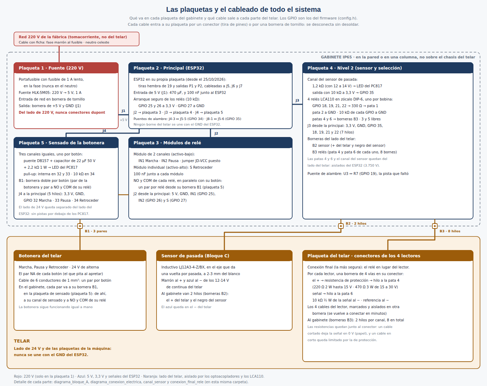
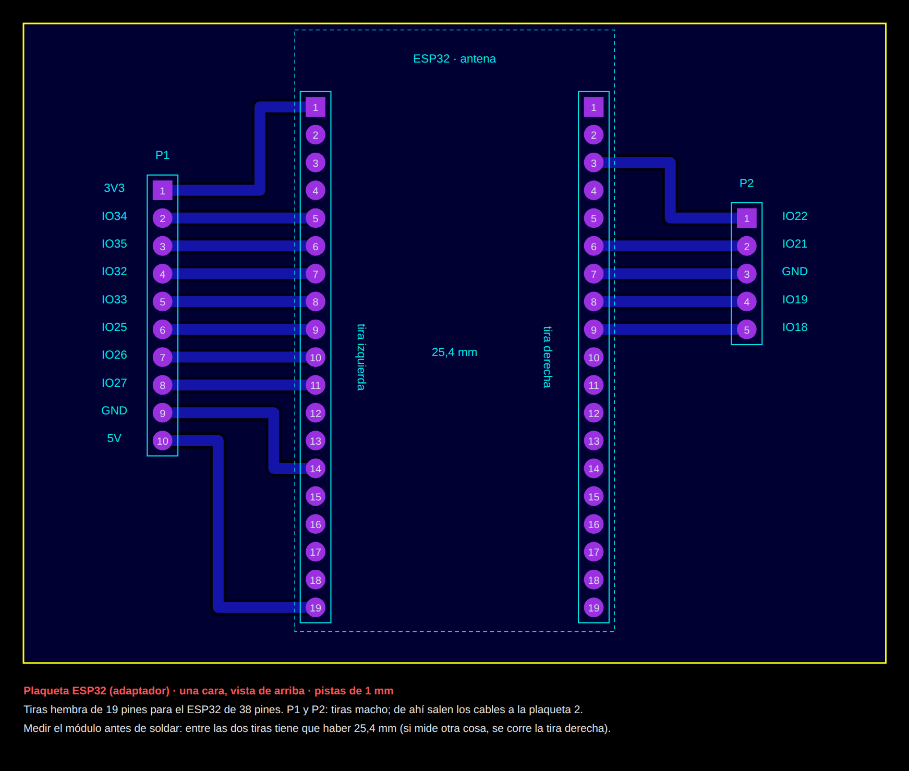

# Paso a paso: conexión y puesta en marcha

*Control de Inserción de Trama · 7mo Informática B, Instituto Leonardo Murialdo*

Esta guía junta en un solo lugar cómo armar las **plaquetas** del gabinete, cómo conectarlas entre sí y al telar, y cómo **levantar el sistema** (el servidor, la web y el ESP32) hasta tejer un dibujo. Se sigue en orden: cada parte se prueba antes de pasar a la siguiente. El detalle de cada bloque está en su propia guía (la lista está al final).

Los dos niveles están instalados y se probaron completos en el telar el 30/10/2026: el **Nivel 1** (Marcha, Pausa y Retroceder por relé, y el sensado de la botonera) y el **Nivel 2** (el sensor de pasada y los cuatro relés de selección del dibujo). Las partes que son solo del Nivel 2 están marcadas.

## 1. Reglas de seguridad (siempre)

- Los cables se conectan y desconectan **siempre con todo desenchufado**: el gabinete (220 V) y el telar.
- Con el telar encendido solo se mide, con las puntas del multímetro y sin tocar nada con la mano, y **sin tejer**.
- La plaqueta de la fuente lleva **220 V**: se arma con el cable desenchufado, sin conectores dupont, con los empalmes aislados, y la primera vez se prueba con el profesor o el técnico.
- El **GND del ESP32 nunca se une con nada del telar** (botonera, sensor, lectores): esa separación es la que protege al ESP32.
- Para programar el ESP32 por USB, **primero se desenchufa la fuente de 220 V**.
- En toda prueba con la máquina, alguien al lado del botón **Stop** del telar (la máquina no tiene una parada de emergencia aparte).
- Si algo se calienta, huele raro o hace un ruido anormal: cortar la alimentación y revisar antes de seguir.

## 2. Qué se necesita

| Qué | Detalle |
|---|---|
| Herramientas | Soldador y estaño, multímetro (tensión, continuidad y corriente), pelacables, destornillador chico, termocontraíble, cinta y marcador para rotular. |
| Componentes | Los de las planillas **Lista de componentes** y **Componentes en placa**: fuente, ESP32, módulos de relé, sensado, sensor, relés LCA110 con zócalos, resistencias, borneras, tiras de pines y cables. |
| Computadora | Con el Arduino IDE y un cable USB **de datos** (los de solo carga no sirven para programar). |
| Cuentas y claves | El servicio en Render, la base en Neon, y las tres claves del servidor: `SESSION_SECRET`, `RECOVERY_SECRET` y `ESP32_DEVICE_KEY`. |

## 3. Las plaquetas y cómo se conectan

El gabinete lleva cinco plaquetas con las conexiones soldadas, más la plaqueta del ESP32 (punto 4.6). Las diseñadas en Proteus (la principal, la de los relés, la del Nivel 2 y la del sensado de la botonera) son impresas; la protoboard sirve para probar, pero la vibración del telar afloja sus contactos. Cada cable entra a su plaqueta por un **conector de tira de pines** o por una **bornera de tornillo**, así todo se desconecta sin desoldar. Del lado de 220 V y del lado del telar, **siempre bornera**.

*Las cinco plaquetas del gabinete, sus conectores y los cables que van al telar (diagramas/hardware/plaquetas_y_cableado.png).*

| Conector | De → a | Hilos | Tipo |
|---|---|---|---|
| Red | Tomacorriente de la fábrica → plaqueta 1 | Fase (marrón) y neutro (celeste) | Bornera de tornillo. Nunca dupont |
| J1 | Plaqueta 1 (fuente) → plaqueta 2 | +5 V y GND | Bornera o tira de pines |
| J2 | Plaqueta 2 → plaqueta 3 (relés) | 5 V, GND, IN1 (GPIO 25), IN2 (GPIO 26), S (GPIO 27) | Tira de pines |
| J3 | Plaqueta 2 → plaqueta 4 (Nivel 2) | 3,3 V, GND, GPIO 35, 18, 19, 21 y 22 | Tira de pines |
| J4 | Plaqueta 2 → plaqueta 5 (sensado) | 3,3 V, GND, GPIO 32, 33 y 34 | Tira de pines |
| B1 | Botonera del telar → plaqueta 5 (sensado), y de ahí a la 3 (relés) | 3 pares: Marcha, Pausa y Retroceder | Bornera de tornillo doble por botón: un par de la botonera y otro a NO y COM de su relé |
| B2 | Sensor de pasada → plaqueta 4 | El + del telar y el negro del sensor | Bornera de tornillo |
| B3 | Bornera de cada lector → plaqueta 4 | Pata 4 y pata 6 de cada relé (8 hilos) | Bornera de tornillo |

> **Nota:** Rotular cada conector y cada bornera antes de cerrar el gabinete (J1 a J4; B1 Marcha, Pausa y Retroceder; B2; B3 canal 1 a 4). Si el Nivel 2 se arma en la misma placa principal, J3 no hace falta: los mismos 7 hilos van soldados. Lo mismo con el sensado: armado en la principal, J4 no hace falta.

## 4. Armar y probar cada plaqueta en el banco (sin el telar)

### 4.1 Plaqueta 1 · Fuente

1. Con el cable desenchufado: la **fase** (marrón) al portafusible con el fusible de **1 A lento**, y de ahí a una pata AC del HLK-5M05. El **neutro** (celeste) a la otra pata AC. Esas dos patas no tienen polaridad. Empalmes con termocontraíble; la entrada, en bornera.
2. **+Vo** y **−Vo** del módulo a la bornera de salida (+5 V y GND). Estas **sí** tienen polaridad: invertirlas quema el ESP32.
3. Sin nada conectado a la salida, enchufar y medir en continua: **entre 4,75 y 5,25 V**. Desenchufar.

### 4.2 Plaqueta 2 · Principal (ESP32)

1. Soldar el conector J1 con el capacitor de **470 µF** (pata larga al +5 V) y un capacitor de **100 nF** entre 3,3 V y GND, y el conector **J4** hacia la plaqueta de sensado (3,3 V del pin 3V3, GND y GPIO 32, 33 y 34). El ESP32 no se enchufa en la principal: va en su propia plaqueta, cableada a J5, J6 y J7 (punto 4.6).
2. Arranque seguro de los relés: **10 kΩ de GPIO 25 a 3,3 V**, **10 kΩ de GPIO 26 a 3,3 V** y **10 kΩ de GPIO 27 a GND** (el módulo de Retroceder se activa con nivel alto).
3. Sin alimentar, con el multímetro en continuidad: entre +5 V y GND **no tiene que pitar** (un pitido corto al principio es normal: es el capacitor de 470 µF que se carga; si pita sin parar, hay un corto).
4. Conectar J1 a la fuente, enchufar y medir **5 V** entre P1-10 y P1-9 de la plaqueta del ESP32, ya cableada (punto 4.6). Desenchufar, poner el ESP32 en su plaqueta (la antena del lado del pin 1) y volver a medir: **3,3 V** en P1-1.

### 4.3 Plaqueta 5 · Sensado de la botonera

Es una plaqueta impresa aparte, unida a la principal por J4.

1. Por canal, los tres iguales: el puente **DB157** con sus patas ~ a la bornera **B1** del botón; un capacitor de **22 µF de 50 V** entre el + y el − del puente (pata larga al +; la botonera rectificada llega a unos 34 V de pico); **2,2 kΩ 1 W** del + del puente a la pata 1 del **PC817**; el − del puente a la pata 2; la pata 3 al GND de J4; la pata 4 al GPIO de J4: GPIO **32** Marcha, **33** Pausa, **34** Retroceder. Solo el 34 lleva **10 kΩ a 3,3 V** (no tiene resistencia interna); el 32 y el 33 usan la pull-up interna del ESP32, que activa el firmware.
2. **B1**, una bornera doble por botón: un par para el cable de la botonera y otro para el cable que va a **NO y COM de su relé** (plaqueta 3), los dos unidos en la plaqueta a las patas ~ del puente.
3. **J4** a la principal, 5 hilos: 3,3 V (del pin 3V3 del ESP32), GND y GPIO 32, 33 y 34.
4. Lo de 24 V (B1, puentes, capacitores, 2,2 kΩ y las patas 1 y 2 de cada PC817) de un lado, y lo del ESP32 (patas 3 y 4, la 10 kΩ del GPIO 34 y J4) del otro, **sin pistas por debajo de los PC817**. Marcar a mano el + de cada capacitor y la pata 1 de cada PC817 y puente: en la plaqueta impresa no sale la serigrafía. Un capacitor invertido puede quedar en corto, y un canal en corto es como dejar el botón apretado.
5. Sin alimentar, con el multímetro en continuidad: entre cualquier borne de B1 y cualquier pin de J4 **no tiene que pitar**.

### 4.4 Plaqueta 3 · Módulos de relé

1. Fijar los dos módulos con separadores o tornillos. En el módulo de 2 canales, el **jumper JD-VCC puesto**.
2. J2: 5 V al VCC de los dos módulos y GND común; **IN1 ← GPIO 25** (Marcha), **IN2 ← GPIO 26** (Pausa) y **S ← GPIO 27** (Retroceder). Un capacitor de 100 nF junto a cada módulo.
3. Las salidas **NO y COM** de cada relé, al par de su bornera B1 en la plaqueta de sensado. La botonera todavía no se conecta.

### 4.5 Plaqueta 4 · Nivel 2

1. Canal del sensor: el borne «+ del telar» de B2 → **1,2 kΩ** → pata 1 de un PC817; el borne «negro del sensor» → pata 2; la pata 3 al GND del ESP32; la pata 4 al **GPIO 35** con **10 kΩ a 3,3 V** (el GPIO 35 no tiene resistencia interna). Si el telar diera 24 V en lugar de 12 a 14 V, la resistencia es de 2,2 kΩ ½ W.
2. Los cuatro **zócalos DIP-6**, con la muesca del lado de la pata 1. Por canal: GPIO → **330 Ω** → pata 1; pata 2 al GND; **10 kΩ del GPIO al GND**, pegada al pin; las **patas 4 y 6** a su par de B3 (rotular canal 1 a 4); las patas 3 y 5 libres. Canales: GPIO **18, 19, 21 y 22**.
3. J3 a la principal (3,3 V, GND, 35, 18, 19, 21 y 22). Poner los LCA110 en los zócalos, con la muesca del lado de la pata 1.
4. Con el multímetro en continuidad: los bornes de B2 y B3 **no pitan** contra el GND del ESP32.

### 4.6 Plaqueta del ESP32 (sumada el 25/10/2026)

En la principal impresa, la tira derecha del ESP32 quedó con los pines en otro orden (J7 antes que J5): el ESP32 no se puede enchufar ahí sin cruzar pines (por ejemplo, los 5 V llegarían al pin CMD). Por eso va en una plaqueta aparte, de una sola cara y sin puentes, con sus dos tiras en el orden correcto, y se cablea a la principal por nombre de señal. No hubo que cambiar el programa.

*La plaqueta del ESP32, vista de arriba (diagramas/hardware/plaqueta_esp32: PNG, SVG y el DXF para importar en ARES).*

1. Antes de soldar, medir el ESP32: entre las dos tiras tiene que haber 25,4 mm. Si mide otra cosa, se corre la tira derecha.
2. Soldar las dos tiras hembra de 19 pines (el pin 1 del lado de la antena) y las tiras macho de salida: P1, de 10 pines, y P2, de 5.
3. En la principal, J5, J6 y J7 no llevan tira: ahí se sueldan los cables que vienen de P1 y P2. J3 queda vacía.
4. De P1 a la principal: 1 3V3 → J5-1 · 2 IO34 → J5-5 · 3 IO35 → J5-6 · 4 IO32 → J5-7 · 5 IO33 → J5-8 · 6 IO25 → J5-9 · 7 IO26 → J7-1 · 8 IO27 → J7-2 · 9 GND → J7-5 · 10 5V → J7-10.
5. De P2 a la principal: 1 IO22 → J6-3 · 2 IO21 → J6-6 · 3 GND → J6-7 · 4 IO19 → J6-8 · 5 IO18 → J6-9. Colores fijos: rojo para 5V, naranja para 3V3 y negro para GND.
6. Puentes de alambre aislado, del lado del cobre y lo más cortos posible, en las pistas que faltaron: en la principal, J4-3 ↔ J5-5 (GPIO 34) y J8-1 ↔ J5-6 (GPIO 35); en la del Nivel 2, U3 ↔ R7 (GPIO 19).
7. Sin el ESP32 puesto, en continuidad: cada salida de P1 y P2 pita contra su pad, ningún cable pita contra el de al lado y cada puente pita de punta a punta.
8. Alimentar la principal todavía sin el ESP32: 5 V entre P1-10 y P1-9, y nada en P1-1 (los 3,3 V los genera el ESP32). Recién ahí enchufar el ESP32, con la antena del lado del pin 1 de las tiras.

## 5. Levantar el servidor y la web

El servidor (backend) corre en **Render** y usa la base de datos de **Neon**. La web la sirve el mismo servidor: no hay nada que instalar en el celular ni en la computadora. Ya está desplegado; estos pasos son para una instalación nueva o después de un cambio.

### 5.1 El servidor (Render y Neon)

1. Respaldo: en Neon, crear una **rama** (branch) de la base. Es una copia instantánea para volver atrás si algo sale mal.
2. En Render, el servicio → **Environment**: `DATABASE_URL` (la de Neon, con `?sslmode=verify-full`), `NODE_ENV=production`, `PGSSL=true`, `SESSION_SECRET`, `RECOVERY_SECRET` y `ESP32_DEVICE_KEY` (tres claves **distintas**, generadas con `node -e "console.log(require('crypto').randomBytes(32).toString('hex'))"`), `WEBAUTHN_RP_ID` (el dominio, sin https) y `WEBAUTHN_ORIGIN` (con https).
3. En **Settings**: Root Directory `backend`, Build Command `npm install`, Start Command `npm start`, Health Check Path `/api/health`.
4. Subir el código a la rama que despliega Render (o **Manual Deploy**). Las migraciones de la base se aplican solas al arrancar: en **Logs** tiene que aparecer «Migraciones al día» y «Servidor escuchando». Una línea con ❌ es una migración que falló: no seguir y revisar el mensaje.
5. Abrir `https://control-trama-backend.onrender.com/api/health`: tiene que responder `{"ok":true,...}`.

> **Nota:** En el plan gratuito, el servidor se duerme después de un rato sin uso y la primera visita tarda cerca de un minuto. Para la producción real conviene correr el mismo sistema en una PC de la red de la planta, sin depender de internet (Manual de instalación, sección 8).

### 5.2 La web

1. Abrir `https://control-trama-backend.onrender.com` desde el celular o la computadora.
2. Entrar con la **huella** (operario). «Continuar sin iniciar sesión» entra como invitado: mira, pero no comanda el telar.
3. Para las primeras pruebas con la máquina se puede apagar «Control desde la página», en la barra de estado del editor: en solo sensado la página no acciona los relés y se ve igual todo lo que sensa el ESP32. Se vuelve a prender con el mismo interruptor.
4. Con la sesión iniciada, abrir `https://control-trama-backend.onrender.com/api/telares`: la web usa el **primero** de la lista. Su `id` es el que va en `TELAR_ID` del firmware (hoy, **8**).

### 5.3 Sin internet o en la escuela (opcional)

Todo el sistema se puede levantar en una PC con Docker: el archivo `backend/.env` con `POSTGRES_PASSWORD`, `SESSION_SECRET`, `RECOVERY_SECRET` y `ESP32_DEVICE_KEY`, y `docker compose up -d --build` en la carpeta `backend`. La web queda en `http://IP-de-la-PC:3000`, y en el firmware `API_BASE_URL` pasa a ser esa dirección. El paso a paso está en el Manual de instalación, sección 3.

## 6. Cargar el firmware del ESP32

1. Arduino IDE: en el gestor de placas, **esp32** de Espressif (versión 3.x); en el gestor de librerías, **ArduinoJson** (versión 7.x).
2. Abrir `esp32/control_trama_esp32/control_trama_esp32.ino` (los demás archivos aparecen como pestañas).
3. En `config.h`, **solo en la copia local** (los datos reales no se suben al repositorio): `WIFI_SSID` y `WIFI_PASSWORD` de la red de la fábrica (y, si se quiere, el celular de respaldo en `WIFI_SSID_ALT`); `API_BASE_URL` (sin barra final); `TELAR_ID` (**8**); `DEVICE_KEY` igual a `ESP32_DEVICE_KEY` de Render, carácter por carácter; `NIVEL2_INSTALADO` en **false** (hoy) o **true** con el sensor y los relés conectados; `MODO_BANCO` en **false**. `CANAL_ACTIVO_EN_ALTO` (true) y `PORCENTAJE_SELECCION` (0) quedan como vienen.
4. Desenchufar la fuente de 220 V. Conectar el ESP32 por USB, elegir la placa **ESP32 Dev Module** y el puerto, y **Subir**.
5. Monitor serie a **115200 baudios**: tiene que aparecer «=== Control de Inserción de Trama ===», el modo («Solo Bloque A» o «Bloques A, C y D») y «Red conectada», sin ningún «401». En la web, junto al estado del telar: **«ESP32 conectado»**.

| Mensaje del monitor serie | Qué significa |
|---|---|
| Red conectada | Todo bien: el LED azul del ESP32 queda encendido. |
| Sin red: el sistema queda en reposo | No se conectó al WiFi: revisar `WIFI_SSID` y `WIFI_PASSWORD`. |
| 401: DEVICE_KEY no coincide… | `DEVICE_KEY` distinta de `ESP32_DEVICE_KEY` de Render. |
| Error consultando estado: HTTP 404 | `TELAR_ID` no existe: revisar el id en `/api/telares`. |
| El telar no tiene un dibujo asignado | Normal hasta tocar ▶ en la web. |
| Botonera: alguien apretó MARCHA (o PAUSA, RETROCEDER) | El sensado vio un botón usado a mano (el aviso sale al soltarlo) y se lo avisa al servidor. |
| Botonera: N canales bajaron juntos… | Se prendió el telar con el gabinete encendido, o volvió su tensión: no es un botón y no se avisa nada. Es normal. |

## 7. Probar todo en el banco (sin el telar)

1. Las plaquetas conectadas entre sí (J1 a J4) y alimentadas con la fuente; el ESP32 con el firmware, ya sin el USB.
2. Reiniciar el ESP32: **ningún relé se dispara solo**. Si alguno se dispara, revisar las resistencias de arranque seguro.
3. En la web, con «Control desde la página» prendido, abrir un dibujo y tocar **▶**: clic del relé de Marcha (un pulso, no queda pegado). **⏸**: clic de Pausa. **⏪** (con confirmación): clic de Retroceder.
4. Sensado: aplicar 24 V de alterna (o de 12 a 24 V de continua) a la entrada de cada canal: el GPIO cae a 0 V y el monitor serie dice «Botonera: alguien apretó …», y la web lo muestra (sección 10). En el telar ese momento es cuando se suelta el botón: en reposo, el par NA tiene 24 V. Con la tensión aplicada a dos o tres canales a la vez, el monitor dice que bajaron juntos y no avisa nada.
5. Nivel 2: con `NIVEL2_INSTALADO` y `MODO_BANCO` en true, un LED con su resistencia y una pila entre las patas 4 y 6 de cada relé. Al tejer desde la web, cada LED se enciende según su columna del dibujo. Después, `MODO_BANCO` vuelve a **false**, y `NIVEL2_INSTALADO` también, hasta conectar el sensor (sección 9).

La lista completa de mediciones de esta etapa está en `esp32/documentacion/CHECKLIST_VALIDACION.md` y en la Guía de mediciones y verificaciones.

## 8. Conectar al telar el Nivel 1 (la botonera)

1. Telar apagado y desenchufado; gabinete desenchufado.
2. Ubicar los dos cables de cada botón (Marcha, Pausa y Retroceder). Si un botón tiene más terminales, con el multímetro en continuidad elegir el par **NA**: no pita en reposo y sí al apretar.
3. Encender el telar y, sin tejer, medir en alterna cada par NA: unos **24 V sin apretar y 0 V apretando**. Si da 0 V sin apretar, ese no es el par NA: no conectarlo. Apagar y desenchufar el telar.
4. Del botón a la bornera **B1** del gabinete, con el cable de 6 conductores (un par por botón), sin cortar ni soldar sobre los cables del telar. No correrlo pegado al cable del motor.
5. En la plaqueta de sensado, cada bornera B1 lleva el par de su botón a **NO y COM de su relé** (en paralelo con el botón), por su otro par, y a la **entrada de su canal de sensado** (las patas ~ del puente).
6. Antes de encender el gabinete, encender el telar y comprobar que **la botonera a mano funciona igual que siempre**.
7. Encender el gabinete. Desde la web, con «Control desde la página» prendido: ▶ arranca la máquina, ⏸ la pausa y ⏪ la hace retroceder una pasada. Con alguien al lado del botón Stop del telar.
8. Apretar los botones a mano, al menos medio segundo cada uno: al soltarlos, la web lo refleja (sección 10).

## 9. Conectar el Nivel 2 (sensor y relés de selección)

> **Atención:** Primero el sensor y después los relés: el Nivel 2 no funciona sin el sensor de pasada, porque cada fila del dibujo se aplica cuando llega su pulso.

### 9.1 Sensor de pasada

1. El sensor, en su soporte sobre el eje que da una vuelta por pasada (ya montado), a **2 o 3 mm** del blanco metálico.
2. Medir la continua que da el telar para el sensor: se esperan **12 a 14 V** (tiene que estar entre 6 y 36 V). Con 24 V, la resistencia del canal es de 2,2 kΩ ½ W.
3. Marrón al **+**, azul al **−** del telar. Al gabinete (B2) van **el + y el negro**. El azul nunca va al GND del ESP32.
4. Con el multímetro en continuidad, la pata 2 del PC817 contra el GND del gabinete **no pita**. Acercar un metal al sensor: se enciende su LED.

### 9.2 Relés de selección (la conexión final)

1. Antes, medir cada lector (Guía de conexión de los relés LCA110, sección 5): la alimentación, la señal con papel y con agujero, y la corriente con la resistencia de protección en serie (menos de **20 mA**). En el C 201 la alimentación dio entre 15 y 30 V (17/10/2026).
2. Con el telar desenchufado, en el conector de cada lector: desconectar los 4 cables del lector, **marcarlos** en las dos puntas y aislarlos en su bornera.
3. En la bornera de 4 vías del conector: el **+** → **resistencia de protección** (220 Ω 2 W hasta 15 V; 470 Ω 3 W de 15 a 30 V, la del C 201) → hilo a la **pata 4**; la **señal** → hilo a la **pata 6**; **10 kΩ ½ W** de la señal al −; la referencia al −.
4. Los 2 hilos de cada canal a su par de **B3**: canal 1 = GPIO 18 = lector y bobina 1; canal 2 = GPIO 19; canal 3 = GPIO 21; canal 4 = GPIO 22. El orden tiene que coincidir con las columnas del dibujo (bobinas 1 a 4).
5. Primero **un solo canal** (el lector 1) y probarlo. Recién después, los otros tres.

### 9.3 Firmware y primera prueba de tejido

1. `NIVEL2_INSTALADO` en **true** y `MODO_BANCO` en **false**; volver a cargar el firmware.
2. Tejer una prueba corta con un dibujo fácil de reconocer y comparar la tela. Si sale corrida una pasada, ajustar `DESPLAZAMIENTO_FILAS` (`PUESTA_EN_MARCHA.md`, sección 2).
3. Validar el conteo durante una jornada contra el contador mecánico del telar y, en la web, tocar **Validar** (`PUESTA_EN_MARCHA.md`, sección 3).

Así se hizo el 30/10/2026: con el gabinete instalado y los cuatro canales conectados, el ESP32 se cargó con `NIVEL2_INSTALADO` en true y los demás valores como vienen (`DESPLAZAMIENTO_FILAS` y `PORCENTAJE_SELECCION` en 0), y la tela salió con el dibujo, sin pasadas corridas. Solo hubo que invertir dos cables en B3 (los canales 2 y 3 estaban cruzados: se vio en la primera vuelta del dibujo) y acercar el sensor a unos 2 mm del blanco. La validación del conteo contra el contador mecánico sigue en el período de prueba, hasta el 04/11/2026.

## 10. El día a día: encender, tejer y la botonera

### Encender

1. Enchufar el gabinete. El LED azul del ESP32 se enciende cuando se conecta a la red. Da lo mismo si el telar ya está prendido o se prende después: al prenderse el telar, los tres canales de la botonera bajan juntos y el ESP32 lo descarta, porque no es un botón.
2. Abrir la web e iniciar sesión: junto al estado del telar tiene que decir **«ESP32 conectado»**. Si el servidor estaba dormido, esperar a que cargue.

### Tejer un dibujo

1. En el editor, abrir (o crear) el dibujo y tocar **▶**: la web se lo asigna al telar y el ESP32 pulsa Marcha.
2. **⏸** pausa, **⏪** retrocede una pasada y **⏹** termina el trabajo (cierra esa producción en el historial).

### Si se aprieta un botón del telar, ¿se ve en la web?

**Sí.** El sensado de la botonera avisa al servidor cuando se suelta el botón, y la web lo muestra en pocos segundos (consulta el estado cada 4 s). Un toque muy corto, de menos de un cuarto de segundo, puede no registrarse:

| Situación | Qué muestra la web |
|---|---|
| Marcha, con un trabajo abierto (se tocó ▶ y no se terminó con ⏹) | Pasa a **«Tejiendo»** y avisa «El telar se puso en marcha desde la botonera». Si el editor tiene abierto ese mismo dibujo (con sesión de operario), la grilla **avanza fila por fila** y el conteo sigue. |
| Pausa | Pasa a **«Pausado»** y la grilla se frena. |
| Retroceder | La posición vuelve una pasada atrás. |
| Marcha, sin un trabajo abierto | Pasa a «Tejiendo», pero el sistema no sabe qué dibujo se está tejiendo: muestra **«Posición incierta (botón Marcha usado a mano)»**. Para ver el dibujo, ponerlo a tejer una vez desde la web (▶) y confirmar la posición. |

> **Nota:** Sin el sensor de pasada (con solo el Nivel 1), el avance que muestra la web es **estimado por tiempo** (300 pasadas por minuto) y dice «Tejiendo (sin confirmar por sensor)». Con el Nivel 2 instalado, como desde el 30/10/2026, la fila y el conteo son los que mide el sensor.

### Apagar

Tocar ⏸ (o ⏹ si se terminó el trabajo) y después desenchufar el gabinete. Si se corta la luz con el telar tejiendo, al volver la web muestra «Pausado: el equipo se reinició» sin perder la posición: mirar el telar, confirmar la posición y seguir con ▶.

## 11. Problemas frecuentes

| Síntoma | Qué revisar |
|---|---|
| La web dice «Sin datos del ESP32» o «Sin conexión» | El WiFi (monitor serie), `TELAR_ID`, y que el servidor esté despierto. |
| El monitor serie muestra «401» | `DEVICE_KEY` distinta de `ESP32_DEVICE_KEY` de Render. |
| Un relé se dispara solo al encender | Las resistencias de arranque: 10 kΩ a 3,3 V en GPIO 25 y 26, a GND en GPIO 27. |
| La web no muestra un botón apretado a mano | Que se haya mantenido apretado al menos un cuarto de segundo; el canal de sensado (con el telar encendido y sin tocar nada, el GPIO da 0 V) y la red del ESP32. |
| Avisos de la botonera sin que nadie apriete nada | Falta el capacitor de 22 µF de ese canal o está invertido. |
| La web dice «Posición incierta» | Se usó la botonera sin un trabajo abierto, o el equipo se reinició: mirar el telar y tocar Confirmar. |
| El ESP32 se reinicia al enganchar un relé | El capacitor de 470 µF en la entrada de 5 V y los de 100 nF junto a cada módulo. |
| El ESP32 no arranca o se calienta en su plaqueta | Un cable de P1 o P2 en el pad equivocado: desenchufar enseguida y revisar con la lista del punto 4.6 (los 5 V van solo a P1-10). |
| «Pausado: sin señal del sensor» (Nivel 2) | La máquina se frenó o el sensor perdió el blanco (distancia, cable). |
| La tela sale corrida una pasada (Nivel 2) | `DESPLAZAMIENTO_FILAS` o la posición del blanco en el eje. |

## 12. Dónde está cada detalle

| Tema | Documento |
|---|---|
| Las plaquetas y el cableado | `diagramas/hardware/plaquetas_y_cableado.png` |
| La plaqueta del ESP32 | `diagramas/hardware/plaqueta_esp32` · Conexiones de las plaquetas (sección 4.6) |
| Nivel 1 (botonera, fuente, sensado) | Guía de armado del Bloque A · `diagrama_bloque_A.png` · `diagrama_conexion_electrica.png` |
| Sensor de pasada | Conexionado del Nivel 2 · Guía de los Bloques C y D · `canal_sensor.png` |
| Relés de selección | Guía de conexión de los relés LCA110 · `PASO_A_PASO_RELES_LCA110.md` · `conexion_final_rele.png` |
| Mediciones y pruebas | Guía de mediciones y verificaciones · `CHECKLIST_VALIDACION.md` |
| Servidor y web | `DESPLIEGUE_RENDER.md` · Manual de instalación y funcionamiento |
| Sincronización y validación del conteo | `PUESTA_EN_MARCHA.md` |
| Componentes | Lista de componentes · Componentes en placa |
